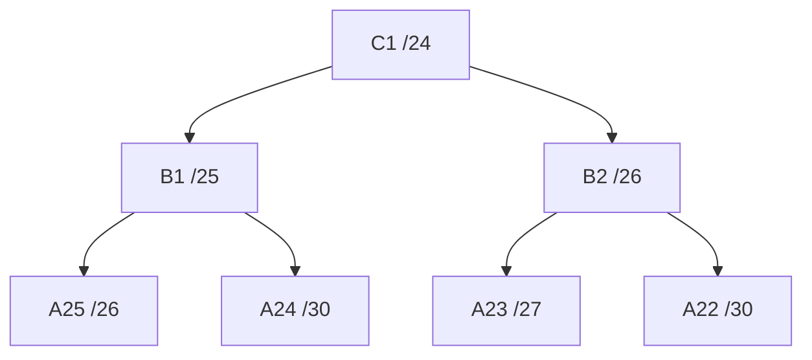

# K12 - Contekan Demo CIDR

Buka CPT dan spreadsheet. Ikuti urutan di bawah; kotak kutipan berisi kalimat yang bisa dibaca saat demo.

## 1. Pembuka

Tunjukkan topologi, lalu ucapkan:

> “Kami menggunakan CIDR dengan prefix 192.217.x.x. Ada 25 subnet internal. Kebutuhan IP dihitung dari jumlah host ditambah interface router.”

Cyberia menjadi pintu keluar. Wired menjadi pusat percabangan.

## 2. Jelaskan satu contoh hitungan: A25

Buka tabel A25 pada spreadsheet.

> “Lain membutuhkan 57 host dan Mika 4 host. Ditambah satu interface router, totalnya 62. Kami memakai /26 karena menyediakan 62 alamat usable.”

```text
57 + 4 + 1 = 62
2^6 - 2 = 62
32 - 6 = /26
```

| Yang ditunjukkan | Nilai |
| --- | --- |
| Network A25 | 192.217.15.128/26 |
| Netmask | 255.255.255.192 |
| Gateway | 192.217.15.129 |
| IP Lain | 192.217.15.130 |
| IP Mika | 192.217.15.131 |
| Broadcast | 192.217.15.191 |

Kalau ditanya “kenapa bukan /27?”: **/27 hanya menyediakan 30 alamat usable, sehingga tidak cukup.**

## 3. Jelaskan pohon CIDR

Buka pohon pada laporan atau sheet Penggabungan - CIDR.

> “Kami menggabungkan subnet dari cabang terluar menuju pusat. Contohnya A25 dan A24 menjadi B1. Penggabungan dilanjutkan sampai blok induk I1, yaitu 192.217.0.0/18.”



Pada pohon alokasi ini, anak ditempatkan pada bagian berbeda di dalam blok induk dan mengikuti batas network. Prefix induk satu tingkat lebih pendek dari prefix anak yang terpendek. Seluruh tahap B-I dapat ditunjukkan pada spreadsheet.

**Ingat:** /18 adalah blok agregat keseluruhan. Mask pada Mika tetap /26.

## 4. Jelaskan routing

Buka **Wired → CLI**. Jalankan per baris:

```text
enable
show ip interface brief
show ip route
show ip route 192.217.15.131
```

Lalu ucapkan:

> “IP Mika berada dalam 192.217.0.0/20. Wired mengirimkannya ke 192.217.2.2, yaitu Tachibana. Router berikutnya meneruskan paket sesuai routing masing-masing.”

Baris konfigurasi yang menjelaskan contoh tersebut:

```text
ip route 192.217.0.0 255.255.240.0 192.217.2.2
```

Jika ditanya rute balik:

> “Router cabang menggunakan default route ke induknya. Contohnya, default route Shibuya menuju Phantoma.”

Jika ditanya kode routing: **C = connected, L = IP router sendiri, S = static, S* = default static.**

Jika ditanya Null0:

> “Null0 membuang paket ke ruang agregat yang tidak memiliki rute lebih spesifik agar tidak terjadi loop.”

## 5. Jalankan tiga jenis ping internal

### A. Router ke router

Pada **Wired → CLI**:

```text
ping 192.217.2.2
```

> “Ini ping dari Wired ke router Tachibana.”

### B. Router ke client

Masih pada **Wired → CLI**:

```text
ping 192.217.15.131
```

> “Ini ping dari Wired ke client Mika yang berada di cabang Shibuya.”

### C. Client ke client

Buka **Omnipresence → Desktop → Command Prompt**:

```text
ipconfig /all
ping 192.217.24.1
ping 192.217.15.131
tracert 192.217.15.131
```

> “Saya periksa IP client, lalu gateway, kemudian koneksi ke Mika pada subnet berbeda. Tracert dipakai untuk melihat hop yang dilewati.”

Tes arah sebaliknya dari **Mika → Command Prompt**:

```text
ping 192.217.24.2
```

## 6. Demo jaringan luar

**File internal awal belum memiliki WAN/NAT yang lengkap.** Siapkan tambahan pada bagian terlipat di bawah sebelum mendemokan langkah ini.

Setelah tambahan WAN/NAT dibuat, dari **Cyberia → CLI**:

```text
ping 203.0.113.1
```

Dari **Omnipresence → Command Prompt**:

```text
ping 198.51.100.10
```

Segera setelah itu, dari **Cyberia → CLI**:

```text
show ip nat translations
show ip nat statistics
```

> “Trafik client internal diterjemahkan oleh Cyberia menjadi alamat WAN sebelum menuju server luar.”

Target 198.51.100.10 adalah server luar **simulasi di CPT**, bukan bukti akses Internet nyata. Ping dari Cyberia sendiri belum membuktikan NAT client; tampilkan tabel NAT setelah ping dari Omnipresence.

---

<details>
<summary><strong>Tambahan sebelum demo: setup WAN/NAT</strong> — buka hanya ketika menyiapkan jaringan luar</summary>

### Ruang lingkup tambahan WAN

Pada konfigurasi internal awal, Cyberia Fa0/0 disiapkan sebagai klien DHCP menuju Cloud, dan NAT belum dipasang. Bagian ini adalah **rancangan tambahan yang perlu diterapkan pada salinan file CPT** sebelum demo jaringan luar. Simpan salinan tersebut, misalnya sebagai `CIDR_Demo_WAN.pkt`.

Jaringan luar pada contoh ini merupakan **simulasi di Packet Tracer**. Server-Luar beralamat 198.51.100.10 adalah perangkat yang dibuat di dalam simulasi; ping ke sana tidak membuktikan akses ke Internet nyata.

### Perangkat dan sambungan tambahan

Tambahkan satu Cable Modem-PT, satu router 2811 bernama **ISP**, serta satu Server-PT bernama **Server-Luar**. Ganti sambungan WAN langsung Cyberia–Cloud menjadi susunan berikut.

| Perangkat/port pertama | Perangkat/port kedua | Kabel |
| --- | --- | --- |
| Cyberia FastEthernet0/0 | Ethernet Cable Modem, biasanya Port1 | Ethernet; pilih koneksi otomatis. |
| Coaxial Cable Modem, biasanya Port0 | Cloud Coaxial7 | Coaxial. |
| Cloud Ethernet6 | ISP FastEthernet0/0 | Ethernet; pilih koneksi otomatis. |
| ISP FastEthernet0/1 | Server-Luar FastEthernet0 | Ethernet; pilih koneksi otomatis. |

Nama port Cloud pada contoh adalah Ethernet6 dan Coaxial7. Sesuaikan nomor jika Cloud yang digunakan memiliki penomoran berbeda. Cable Modem dan Cloud meneruskan sambungan; proses NAT dilakukan pada Cyberia.

### Konfigurasi sambungan Cloud

1. Buka **Cloud → Config → Ethernet6**.
2. Ubah **Provider Network** menjadi **Cable**.
3. Buka **Connections → Cable**.
4. Pasangkan **Coaxial7** dengan **Ethernet6**.
5. Klik **Add**.

Pemetaan port tersebut diperlukan agar trafik dapat diteruskan antara sisi modem dan sisi ISP.

### Alamat sisi luar

| Perangkat/interface | IP | Subnet mask | Gateway |
| --- | --- | --- | --- |
| Cyberia Fa0/0 | 203.0.113.2 | 255.255.255.252 | Default route ke 203.0.113.1 |
| ISP Fa0/0 | 203.0.113.1 | 255.255.255.252 | - |
| ISP Fa0/1 | 198.51.100.1 | 255.255.255.0 | - |
| Server-Luar | 198.51.100.10 | 255.255.255.0 | 198.51.100.1 |

Alamat sisi luar ini merupakan contoh tambahan dan tidak mengubah alokasi 25 subnet internal 192.217.x.x.

### Konfigurasi router ISP

Jalankan pada **ISP → CLI**:

```text
enable
configure terminal
hostname ISP

interface FastEthernet0/0
 ip address 203.0.113.1 255.255.255.252
 no shutdown
 exit

interface FastEthernet0/1
 ip address 198.51.100.1 255.255.255.0
 no shutdown
 exit

end
copy running-config startup-config
```

Tekan Enter jika diminta nama file tujuan ketika menyimpan konfigurasi.

### Konfigurasi Server-Luar

Buka **Server-Luar → Desktop → IP Configuration → Static**, kemudian masukkan:

```text
IP address      : 198.51.100.10
Subnet mask     : 255.255.255.0
Default gateway : 198.51.100.1
```

DNS tidak diperlukan untuk command ping yang menggunakan alamat IP langsung.

### Konfigurasi WAN dan NAT pada Cyberia

Baris `no ip address` di Fa0/0 menghapus pengaturan alamat sebelumnya, kemudian alamat WAN ditetapkan secara statis. Interface internal dan rute internal yang sudah ada tetap digunakan.

```text
enable
configure terminal

interface FastEthernet0/0
 no ip address
 ip address 203.0.113.2 255.255.255.252
 ip nat outside
 no shutdown
 exit

interface FastEthernet0/1
 ip nat inside
 exit

interface FastEthernet1/0
 ip nat inside
 exit

access-list 1 permit 192.217.0.0 0.0.63.255
ip nat inside source list 1 interface FastEthernet0/0 overload
ip route 0.0.0.0 0.0.0.0 203.0.113.1

end
copy running-config startup-config
```

| Bagian konfigurasi | Penjelasan |
| --- | --- |
| Fa0/0: `ip nat outside` | Interface menuju sambungan luar. |
| Fa0/1: `ip nat inside` | Interface internal yang menuju Wired. |
| Fa1/0: `ip nat inside` | Interface internal yang menuju LAN Cyberia. |
| `access-list 1 permit 192.217.0.0 0.0.63.255` | Memilih alamat sumber pada blok internal /18 untuk diterjemahkan. |
| `interface FastEthernet0/0 overload` | Menggunakan alamat WAN Fa0/0 untuk translasi beberapa perangkat internal. |
| Default route ke 203.0.113.1 | Mengirim tujuan di luar rute internal menuju router ISP. |

Wildcard /18 diperoleh dari `255.255.255.255 - 255.255.192.0 = 0.0.63.255`. Di dalam contoh ini, alamat sumber client diterjemahkan menjadi alamat WAN Cyberia **203.0.113.2**. Overload/PAT membedakan aliran menggunakan informasi protokol; untuk trafik ICMP, identifier ICMP ikut digunakan.

> “Cyberia menjadi batas jaringan internal dan eksternal. Dua interface internal ditandai NAT inside dan interface WAN ditandai NAT outside. NAT overload menerjemahkan sumber internal menggunakan alamat WAN Cyberia.”

Router ISP tidak memerlukan rute ke seluruh subnet internal untuk balasan trafik PAT ini, karena balasan diarahkan ke alamat WAN Cyberia. Cyberia menerjemahkan balasan dan meneruskannya ke jaringan internal menggunakan routing yang sudah tersedia.

### Urutan command demo jaringan luar

Pertama, dari **Cyberia → CLI**:

```text
enable
show ip interface brief
show ip route
ping 203.0.113.1
ping 198.51.100.10
```

Lalu dari **Omnipresence → Desktop → Command Prompt**:

```text
ping 203.0.113.1
ping 198.51.100.10
tracert 198.51.100.10
```

Segera setelah ping dari client, tampilkan pada **Cyberia → CLI**:

```text
show ip nat translations
show ip nat statistics
```

> “Ping dari Cyberia memeriksa koneksi sisi WAN. Ping dari Omnipresence memeriksa perjalanan trafik internal ke jaringan luar melalui NAT. Tabel translasi digunakan untuk menunjukkan perubahan alamat sumber client menjadi alamat WAN Cyberia.”

Ping dari Cyberia sendiri belum membuktikan translasi trafik client. Untuk menunjukkan PAT, kirim ping dari client internal lalu segera periksa tabel NAT karena entri ICMP dapat kedaluwarsa.

</details>

Referensi teknis: [CIDR](https://www.rfc-editor.org/rfc/rfc4632.html), [Cloud Packet Tracer](https://tutorials.ptnetacad.net/help/default/config_clouds.htm), dan [NAT Cisco](https://www.cisco.com/c/en/us/support/docs/ip/network-address-translation-nat/13778-9.html).

