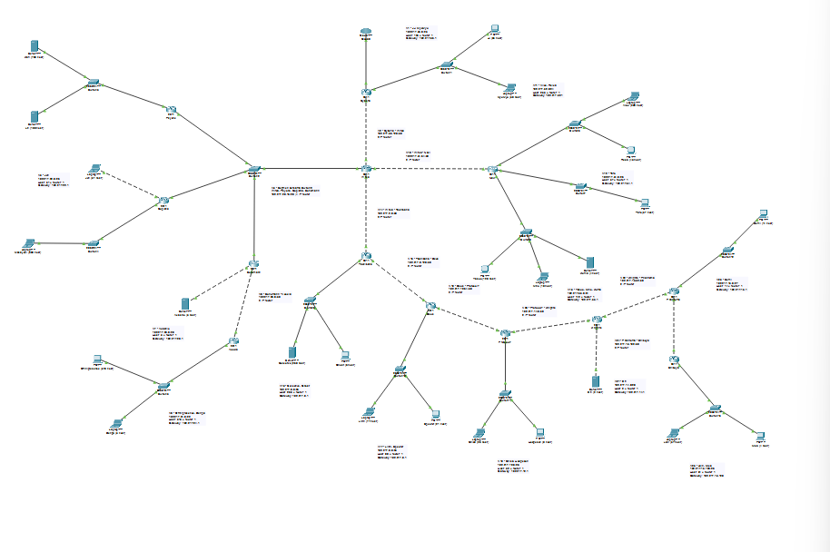
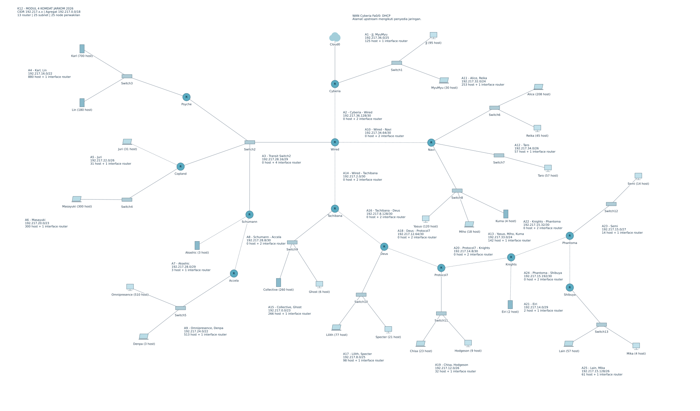
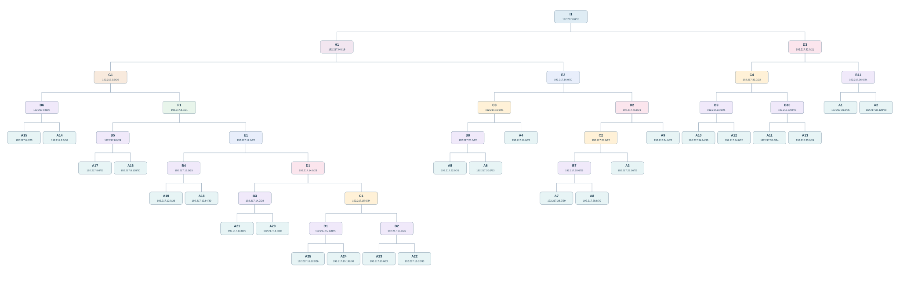

# K12 - Praktikum Modul 4 Komunikasi Data dan Jaringan Komputer 2026

## Subnetting CIDR pada Cisco Packet Tracer

Laporan ini membahas pembagian alamat IPv4, penggabungan subnet secara CIDR, penempatan alamat pada perangkat, dan routing statis untuk topologi **Serial Experiments Lain - The Wired Expansion**. Prefix kelompok yang digunakan adalah **192.217.x.x**.

Ruang lingkup laporan ini adalah implementasi **CIDR pada Cisco Packet Tracer**. Untuk memenuhi ketentuan dua metode yang berbeda pada modul, bagian GNS3 perlu menggunakan VLSM. Proyek GNS3 tidak termasuk dalam paket ini.

| Komponen | Keterangan |
| --- | --- |
| Kelompok | K12 |
| Metode di CPT | CIDR |
| Prefix kelompok | 192.217.x.x |
| Blok induk hasil pohon CIDR | 192.217.0.0/18 |
| Router | 13 |
| Switch | 13 |
| Perangkat akhir perwakilan | 25 |
| Subnet internal | 25 |
| Versi file Packet Tracer | 9.0.1.0858 |

## Daftar isi

- [Berkas laporan](#berkas-laporan)
- [Topologi](#topologi)
- [Dasar perhitungan](#dasar-perhitungan)
- [Rekap kebutuhan setiap subnet](#rekap-kebutuhan-setiap-subnet)
- [Perhitungan subnet satu per satu](#perhitungan-subnet-satu-per-satu)
- [Penggabungan CIDR bertahap](#penggabungan-cidr-bertahap)
- [Pembagian alamat akhir](#pembagian-alamat-akhir)
- [Konfigurasi dan routing](#konfigurasi-dan-routing)
- [Command check](#command-check)
- [Referensi](#referensi)

## Berkas laporan

| Berkas | Isi |
| --- | --- |
| [File Cisco Packet Tracer](packet-tracer/K12_Modul4_CIDR_Rapi.pkt) | Topologi tanpa lingkaran, label subnet diperbesar dan dirapikan; konfigurasi alamat serta routing dipertahankan. |
| [Spreadsheet perhitungan](perhitungan/K12_Modul4_Perhitungan_CIDR.xlsx) | Template berisi Rute, Pembagian IP - VLSM, Penggabungan - CIDR, serta Pembagian IP - CIDR. |
| [Konfigurasi router](konfigurasi/router/) | Startup configuration dari 13 router. |
| [Konfigurasi switch](konfigurasi/switch/) | Startup configuration dari 13 switch. |
| [Command pemeriksaan router](commands/cek_router.txt) | Perintah untuk memeriksa interface, routing, dan konfigurasi. |
| [Command ping dari Wired](commands/cek_wired_semua_host.txt) | Daftar ping ke seluruh 25 perangkat perwakilan. |

## Topologi

### Screenshot Cisco Packet Tracer



*Screenshot topologi yang dikirimkan pengguna dari sesi Packet Tracer. Label pada file `.pkt` dalam paket ini telah dirapikan dan pengaturan huruf workspace dinaikkan dari 8 menjadi 12 poin.*

### Diagram topologi dengan label yang dirapikan



*Diagram dokumentasi dibuat dari koordinat perangkat dan sambungan pada file akhir; gambar ini bukan screenshot aplikasi. [Buka diagram ukuran penuh](assets/diagram/topologi-rapi.svg) untuk membaca label.*

Cyberia merupakan satu-satunya router yang terhubung ke Cloud. Wired menjadi pusat percabangan menuju Cyberia, Navi, Tachibana, serta segmen bersama Switch2. Switch2 menghubungkan Wired, Psyche, Copland, dan Schumann dalam satu broadcast domain. Cabang terdalam mengikuti jalur Tachibana - Deus - Protocol7 - Knights - Phantoma - Shibuya.

Setiap ikon PC, laptop, atau server mewakili kelompok host sesuai jumlah pada soal. Contohnya, ikon Karl mewakili kebutuhan 700 host, bukan berarti 700 perangkat fisik dibuat dalam simulasi. Switch Layer 2 tidak diberi IP manajemen pada konfigurasi ini sehingga tidak menambah kebutuhan IP host.

## Dasar perhitungan

### Menghitung kebutuhan alamat

```text
H = jumlah host pada subnet + jumlah interface router pada subnet
Pilih h terkecil sehingga 2^h - 2 >= H
Prefix = 32 - h
Ukuran blok = 2^h
Kapasitas usable = 2^h - 2
```

Dua alamat pada setiap subnet IPv4 biasa digunakan sebagai network ID dan broadcast. Semua link antarrouter dalam laporan ini menggunakan /30, bukan /31. Gateway pada LAN memakai alamat usable pertama. Pada segmen bersama A3, empat interface router dihitung dalam satu subnet /29.

### Menentukan network ID dan broadcast

```text
Network ID = alamat awal blok yang sejajar dengan prefix
Broadcast = Network ID + ukuran blok - 1
First usable = Network ID + 1
Last usable = Broadcast - 1
Sisa usable = kapasitas usable - kebutuhan alamat
```

Network ID harus mengikuti batas blok. Sebagai contoh, /22 memiliki blok 4 pada oktet ketiga, sehingga 192.217.16.0/22 mencakup 192.217.16.0 sampai 192.217.19.255.

### Membedakan subnet awal, agregat, dan implementasi routing

Prefix A1-A25 berasal dari kebutuhan host tiap broadcast domain. Kelompok B-I adalah blok induk untuk menyusun pohon alokasi CIDR. Agregat tidak membentuk broadcast domain baru dan tidak dipasang sebagai netmask pada PC. Setiap PC tetap memakai netmask subnet A masing-masing.

Dalam pohon praktikum ini, dua cabang ditempatkan pada dua bagian blok induk. Prefix induk dipilih satu tingkat lebih pendek daripada prefix anak yang paling pendek: `P_induk = min(P_anak1, P_anak2) - 1`. Network ID kedua anak juga harus berada pada bagian yang berbeda dan sejajar di dalam induk. Rumus ini menjelaskan konstruksi pohon alokasi; agregasi umum untuk alamat yang sudah ada tetap harus mengikuti prefix bersama dan batas jaringan.

## Rekap kebutuhan setiap subnet

| Subnet | Segmen | Host | Interface router | Kebutuhan H | Prefix | Usable |
| --- | --- | --- | --- | --- | --- | --- |
| A1 | Cyberia → Switch1 → JJ, MyuMyu | 125 | 1 | 126 | /25 | 126 |
| A2 | Cyberia → Wired | 0 | 2 | 2 | /30 | 2 |
| A3 | Wired → Switch2 → Psyche, Copland, Schumann | 0 | 4 | 4 | /29 | 6 |
| A4 | Psyche → Switch3 → Karl, Lin | 880 | 1 | 881 | /22 | 1022 |
| A5 | Copland → Juri | 31 | 1 | 32 | /26 | 62 |
| A6 | Copland → Switch4 → Masayuki | 300 | 1 | 301 | /23 | 510 |
| A7 | Schumann → Akashic | 3 | 1 | 4 | /29 | 6 |
| A8 | Schumann → Accela | 0 | 2 | 2 | /30 | 2 |
| A9 | Accela → Switch5 → Omnipresence, Denpa | 513 | 1 | 514 | /22 | 1022 |
| A10 | Wired → Navi | 0 | 2 | 2 | /30 | 2 |
| A11 | Navi → Switch6 → Alice, Reika | 253 | 1 | 254 | /24 | 254 |
| A12 | Navi → Switch7 → Taro | 57 | 1 | 58 | /26 | 62 |
| A13 | Navi → Switch8 → Yasuo, Miho, Kuma | 142 | 1 | 143 | /24 | 254 |
| A14 | Wired → Tachibana | 0 | 2 | 2 | /30 | 2 |
| A15 | Tachibana → Switch9 → Collective, Ghost | 266 | 1 | 267 | /23 | 510 |
| A16 | Tachibana → Deus | 0 | 2 | 2 | /30 | 2 |
| A17 | Deus → Switch10 → Lilith, Specter | 98 | 1 | 99 | /25 | 126 |
| A18 | Deus → Protocol7 | 0 | 2 | 2 | /30 | 2 |
| A19 | Protocol7 → Switch11 → Chisa, Hodgeson | 32 | 1 | 33 | /26 | 62 |
| A20 | Protocol7 → Knights | 0 | 2 | 2 | /30 | 2 |
| A21 | Knights → Eiri | 2 | 1 | 3 | /29 | 6 |
| A22 | Knights → Phantoma | 0 | 2 | 2 | /30 | 2 |
| A23 | Phantoma → Switch12 → Semi | 14 | 1 | 15 | /27 | 30 |
| A24 | Phantoma → Shibuya | 0 | 2 | 2 | /30 | 2 |
| A25 | Shibuya → Switch13 → Lain, Mika | 61 | 1 | 62 | /26 | 62 |

Jumlah kebutuhan host adalah **2.777**, ditambah **37 interface router internal**, sehingga kebutuhan alamat usable menjadi **2.814**. Total ukuran blok subnet A adalah **4.188 alamat**, sedangkan blok induk CIDR /18 menyediakan **16.384 alamat**. Selisih blok induk terhadap jumlah blok A adalah ruang yang belum ditempati subnet, bukan host aktif. CIDR bertingkat menyediakan ruang pada agregat; laporan ini tidak mengklaim seluruh alamat pada /18 terpakai.

## Perhitungan subnet satu per satu

### A1 - JJ, MyuMyu

Segmen: **Cyberia → Switch1 → JJ, MyuMyu**.

Kebutuhan host: JJ (95) + MyuMyu (30).

`H = 125 + 1 = 126`. Dengan `h = 7`, kapasitasnya `2^7 - 2 = 126`. Blok satu tingkat lebih kecil hanya menyediakan `62` alamat usable sehingga tidak cukup. Prefix yang dipakai adalah **/25**.

| Parameter | Nilai |
| --- | --- |
| Jumlah host | 125 |
| Interface router | 1 |
| Kebutuhan usable | 126 |
| Network ID/prefix | 192.217.36.0/25 |
| Subnet mask | 255.255.255.128 |
| Ukuran blok | 128 |
| Kapasitas usable | 126 |
| First usable | 192.217.36.1 |
| Last usable | 192.217.36.126 |
| Broadcast | 192.217.36.127 |
| Sisa usable | 0 |

| Perangkat | Interface | IP yang digunakan |
| --- | --- | --- |
| Cyberia | FastEthernet1/0 | 192.217.36.1 |
| JJ | FastEthernet0 | 192.217.36.2 |
| MyuMyu | FastEthernet0 | 192.217.36.3 |

Gateway seluruh perangkat akhir pada subnet ini: **192.217.36.1**.

### A2 - Transit Cyberia, Wired

Segmen: **Cyberia → Wired**.

Segmen ini hanya memuat interface router, tanpa kelompok host akhir.

`H = 0 + 2 = 2`. Dengan `h = 2`, kapasitasnya `2^2 - 2 = 2`. Blok satu tingkat lebih kecil hanya menyediakan `0` alamat usable sehingga tidak cukup. Prefix yang dipakai adalah **/30**.

| Parameter | Nilai |
| --- | --- |
| Jumlah host | 0 |
| Interface router | 2 |
| Kebutuhan usable | 2 |
| Network ID/prefix | 192.217.36.128/30 |
| Subnet mask | 255.255.255.252 |
| Ukuran blok | 4 |
| Kapasitas usable | 2 |
| First usable | 192.217.36.129 |
| Last usable | 192.217.36.130 |
| Broadcast | 192.217.36.131 |
| Sisa usable | 0 |

| Perangkat | Interface | IP yang digunakan |
| --- | --- | --- |
| Cyberia | FastEthernet0/1 | 192.217.36.129 |
| Wired | FastEthernet0/0 | 192.217.36.130 |

### A3 - Transit Wired, Psyche, Copland, Schumann

Segmen: **Wired → Switch2 → Psyche, Copland, Schumann**.

Segmen ini hanya memuat interface router, tanpa kelompok host akhir.

`H = 0 + 4 = 4`. Dengan `h = 3`, kapasitasnya `2^3 - 2 = 6`. Blok satu tingkat lebih kecil hanya menyediakan `2` alamat usable sehingga tidak cukup. Prefix yang dipakai adalah **/29**.

| Parameter | Nilai |
| --- | --- |
| Jumlah host | 0 |
| Interface router | 4 |
| Kebutuhan usable | 4 |
| Network ID/prefix | 192.217.28.16/29 |
| Subnet mask | 255.255.255.248 |
| Ukuran blok | 8 |
| Kapasitas usable | 6 |
| First usable | 192.217.28.17 |
| Last usable | 192.217.28.22 |
| Broadcast | 192.217.28.23 |
| Sisa usable | 2 |

| Perangkat | Interface | IP yang digunakan |
| --- | --- | --- |
| Wired | FastEthernet0/1 | 192.217.28.17 |
| Psyche | FastEthernet0/0 | 192.217.28.18 |
| Copland | FastEthernet0/0 | 192.217.28.19 |
| Schumann | FastEthernet0/0 | 192.217.28.20 |

Keempat router pada Switch2 memakai subnet yang sama. Subnet A3 tidak dipecah menjadi empat link /30.

### A4 - Karl, Lin

Segmen: **Psyche → Switch3 → Karl, Lin**.

Kebutuhan host: Karl (700) + Lin (180).

`H = 880 + 1 = 881`. Dengan `h = 10`, kapasitasnya `2^10 - 2 = 1022`. Blok satu tingkat lebih kecil hanya menyediakan `510` alamat usable sehingga tidak cukup. Prefix yang dipakai adalah **/22**.

| Parameter | Nilai |
| --- | --- |
| Jumlah host | 880 |
| Interface router | 1 |
| Kebutuhan usable | 881 |
| Network ID/prefix | 192.217.16.0/22 |
| Subnet mask | 255.255.252.0 |
| Ukuran blok | 1024 |
| Kapasitas usable | 1022 |
| First usable | 192.217.16.1 |
| Last usable | 192.217.19.254 |
| Broadcast | 192.217.19.255 |
| Sisa usable | 141 |

| Perangkat | Interface | IP yang digunakan |
| --- | --- | --- |
| Psyche | FastEthernet0/1 | 192.217.16.1 |
| Karl | FastEthernet0 | 192.217.16.2 |
| Lin | FastEthernet0 | 192.217.16.3 |

Gateway seluruh perangkat akhir pada subnet ini: **192.217.16.1**.

### A5 - Juri

Segmen: **Copland → Juri**.

Kebutuhan host: Juri (31).

`H = 31 + 1 = 32`. Dengan `h = 6`, kapasitasnya `2^6 - 2 = 62`. Blok satu tingkat lebih kecil hanya menyediakan `30` alamat usable sehingga tidak cukup. Prefix yang dipakai adalah **/26**.

| Parameter | Nilai |
| --- | --- |
| Jumlah host | 31 |
| Interface router | 1 |
| Kebutuhan usable | 32 |
| Network ID/prefix | 192.217.22.0/26 |
| Subnet mask | 255.255.255.192 |
| Ukuran blok | 64 |
| Kapasitas usable | 62 |
| First usable | 192.217.22.1 |
| Last usable | 192.217.22.62 |
| Broadcast | 192.217.22.63 |
| Sisa usable | 30 |

| Perangkat | Interface | IP yang digunakan |
| --- | --- | --- |
| Copland | FastEthernet0/1 | 192.217.22.1 |
| Juri | FastEthernet0 | 192.217.22.2 |

Gateway seluruh perangkat akhir pada subnet ini: **192.217.22.1**.

### A6 - Masayuki

Segmen: **Copland → Switch4 → Masayuki**.

Kebutuhan host: Masayuki (300).

`H = 300 + 1 = 301`. Dengan `h = 9`, kapasitasnya `2^9 - 2 = 510`. Blok satu tingkat lebih kecil hanya menyediakan `254` alamat usable sehingga tidak cukup. Prefix yang dipakai adalah **/23**.

| Parameter | Nilai |
| --- | --- |
| Jumlah host | 300 |
| Interface router | 1 |
| Kebutuhan usable | 301 |
| Network ID/prefix | 192.217.20.0/23 |
| Subnet mask | 255.255.254.0 |
| Ukuran blok | 512 |
| Kapasitas usable | 510 |
| First usable | 192.217.20.1 |
| Last usable | 192.217.21.254 |
| Broadcast | 192.217.21.255 |
| Sisa usable | 209 |

| Perangkat | Interface | IP yang digunakan |
| --- | --- | --- |
| Copland | FastEthernet1/0 | 192.217.20.1 |
| Masayuki | FastEthernet0 | 192.217.20.2 |

Gateway seluruh perangkat akhir pada subnet ini: **192.217.20.1**.

### A7 - Akashic

Segmen: **Schumann → Akashic**.

Kebutuhan host: Akashic (3).

`H = 3 + 1 = 4`. Dengan `h = 3`, kapasitasnya `2^3 - 2 = 6`. Blok satu tingkat lebih kecil hanya menyediakan `2` alamat usable sehingga tidak cukup. Prefix yang dipakai adalah **/29**.

| Parameter | Nilai |
| --- | --- |
| Jumlah host | 3 |
| Interface router | 1 |
| Kebutuhan usable | 4 |
| Network ID/prefix | 192.217.28.0/29 |
| Subnet mask | 255.255.255.248 |
| Ukuran blok | 8 |
| Kapasitas usable | 6 |
| First usable | 192.217.28.1 |
| Last usable | 192.217.28.6 |
| Broadcast | 192.217.28.7 |
| Sisa usable | 2 |

| Perangkat | Interface | IP yang digunakan |
| --- | --- | --- |
| Schumann | FastEthernet0/1 | 192.217.28.1 |
| Akashic | FastEthernet0 | 192.217.28.2 |

Gateway seluruh perangkat akhir pada subnet ini: **192.217.28.1**.

### A8 - Transit Schumann, Accela

Segmen: **Schumann → Accela**.

Segmen ini hanya memuat interface router, tanpa kelompok host akhir.

`H = 0 + 2 = 2`. Dengan `h = 2`, kapasitasnya `2^2 - 2 = 2`. Blok satu tingkat lebih kecil hanya menyediakan `0` alamat usable sehingga tidak cukup. Prefix yang dipakai adalah **/30**.

| Parameter | Nilai |
| --- | --- |
| Jumlah host | 0 |
| Interface router | 2 |
| Kebutuhan usable | 2 |
| Network ID/prefix | 192.217.28.8/30 |
| Subnet mask | 255.255.255.252 |
| Ukuran blok | 4 |
| Kapasitas usable | 2 |
| First usable | 192.217.28.9 |
| Last usable | 192.217.28.10 |
| Broadcast | 192.217.28.11 |
| Sisa usable | 0 |

| Perangkat | Interface | IP yang digunakan |
| --- | --- | --- |
| Schumann | FastEthernet1/0 | 192.217.28.9 |
| Accela | FastEthernet0/0 | 192.217.28.10 |

### A9 - Omnipresence, Denpa

Segmen: **Accela → Switch5 → Omnipresence, Denpa**.

Kebutuhan host: Omnipresence (510) + Denpa (3).

`H = 513 + 1 = 514`. Dengan `h = 10`, kapasitasnya `2^10 - 2 = 1022`. Blok satu tingkat lebih kecil hanya menyediakan `510` alamat usable sehingga tidak cukup. Prefix yang dipakai adalah **/22**.

| Parameter | Nilai |
| --- | --- |
| Jumlah host | 513 |
| Interface router | 1 |
| Kebutuhan usable | 514 |
| Network ID/prefix | 192.217.24.0/22 |
| Subnet mask | 255.255.252.0 |
| Ukuran blok | 1024 |
| Kapasitas usable | 1022 |
| First usable | 192.217.24.1 |
| Last usable | 192.217.27.254 |
| Broadcast | 192.217.27.255 |
| Sisa usable | 508 |

| Perangkat | Interface | IP yang digunakan |
| --- | --- | --- |
| Accela | FastEthernet0/1 | 192.217.24.1 |
| Omnipresence | FastEthernet0 | 192.217.24.2 |
| Denpa | FastEthernet0 | 192.217.24.3 |

Gateway seluruh perangkat akhir pada subnet ini: **192.217.24.1**.

### A10 - Transit Wired, Navi

Segmen: **Wired → Navi**.

Segmen ini hanya memuat interface router, tanpa kelompok host akhir.

`H = 0 + 2 = 2`. Dengan `h = 2`, kapasitasnya `2^2 - 2 = 2`. Blok satu tingkat lebih kecil hanya menyediakan `0` alamat usable sehingga tidak cukup. Prefix yang dipakai adalah **/30**.

| Parameter | Nilai |
| --- | --- |
| Jumlah host | 0 |
| Interface router | 2 |
| Kebutuhan usable | 2 |
| Network ID/prefix | 192.217.34.64/30 |
| Subnet mask | 255.255.255.252 |
| Ukuran blok | 4 |
| Kapasitas usable | 2 |
| First usable | 192.217.34.65 |
| Last usable | 192.217.34.66 |
| Broadcast | 192.217.34.67 |
| Sisa usable | 0 |

| Perangkat | Interface | IP yang digunakan |
| --- | --- | --- |
| Wired | FastEthernet1/0 | 192.217.34.65 |
| Navi | FastEthernet0/0 | 192.217.34.66 |

### A11 - Alice, Reika

Segmen: **Navi → Switch6 → Alice, Reika**.

Kebutuhan host: Alice (208) + Reika (45).

`H = 253 + 1 = 254`. Dengan `h = 8`, kapasitasnya `2^8 - 2 = 254`. Blok satu tingkat lebih kecil hanya menyediakan `126` alamat usable sehingga tidak cukup. Prefix yang dipakai adalah **/24**.

| Parameter | Nilai |
| --- | --- |
| Jumlah host | 253 |
| Interface router | 1 |
| Kebutuhan usable | 254 |
| Network ID/prefix | 192.217.32.0/24 |
| Subnet mask | 255.255.255.0 |
| Ukuran blok | 256 |
| Kapasitas usable | 254 |
| First usable | 192.217.32.1 |
| Last usable | 192.217.32.254 |
| Broadcast | 192.217.32.255 |
| Sisa usable | 0 |

| Perangkat | Interface | IP yang digunakan |
| --- | --- | --- |
| Navi | FastEthernet0/1 | 192.217.32.1 |
| Alice | FastEthernet0 | 192.217.32.2 |
| Reika | FastEthernet0 | 192.217.32.3 |

Gateway seluruh perangkat akhir pada subnet ini: **192.217.32.1**.

### A12 - Taro

Segmen: **Navi → Switch7 → Taro**.

Kebutuhan host: Taro (57).

`H = 57 + 1 = 58`. Dengan `h = 6`, kapasitasnya `2^6 - 2 = 62`. Blok satu tingkat lebih kecil hanya menyediakan `30` alamat usable sehingga tidak cukup. Prefix yang dipakai adalah **/26**.

| Parameter | Nilai |
| --- | --- |
| Jumlah host | 57 |
| Interface router | 1 |
| Kebutuhan usable | 58 |
| Network ID/prefix | 192.217.34.0/26 |
| Subnet mask | 255.255.255.192 |
| Ukuran blok | 64 |
| Kapasitas usable | 62 |
| First usable | 192.217.34.1 |
| Last usable | 192.217.34.62 |
| Broadcast | 192.217.34.63 |
| Sisa usable | 4 |

| Perangkat | Interface | IP yang digunakan |
| --- | --- | --- |
| Navi | FastEthernet1/0 | 192.217.34.1 |
| Taro | FastEthernet0 | 192.217.34.2 |

Gateway seluruh perangkat akhir pada subnet ini: **192.217.34.1**.

### A13 - Yasuo, Miho, Kuma

Segmen: **Navi → Switch8 → Yasuo, Miho, Kuma**.

Kebutuhan host: Yasuo (120) + Miho (18) + Kuma (4).

`H = 142 + 1 = 143`. Dengan `h = 8`, kapasitasnya `2^8 - 2 = 254`. Blok satu tingkat lebih kecil hanya menyediakan `126` alamat usable sehingga tidak cukup. Prefix yang dipakai adalah **/24**.

| Parameter | Nilai |
| --- | --- |
| Jumlah host | 142 |
| Interface router | 1 |
| Kebutuhan usable | 143 |
| Network ID/prefix | 192.217.33.0/24 |
| Subnet mask | 255.255.255.0 |
| Ukuran blok | 256 |
| Kapasitas usable | 254 |
| First usable | 192.217.33.1 |
| Last usable | 192.217.33.254 |
| Broadcast | 192.217.33.255 |
| Sisa usable | 111 |

| Perangkat | Interface | IP yang digunakan |
| --- | --- | --- |
| Navi | FastEthernet1/1 | 192.217.33.1 |
| Yasuo | FastEthernet0 | 192.217.33.2 |
| Miho | FastEthernet0 | 192.217.33.3 |
| Kuma | FastEthernet0 | 192.217.33.4 |

Gateway seluruh perangkat akhir pada subnet ini: **192.217.33.1**.

### A14 - Transit Wired, Tachibana

Segmen: **Wired → Tachibana**.

Segmen ini hanya memuat interface router, tanpa kelompok host akhir.

`H = 0 + 2 = 2`. Dengan `h = 2`, kapasitasnya `2^2 - 2 = 2`. Blok satu tingkat lebih kecil hanya menyediakan `0` alamat usable sehingga tidak cukup. Prefix yang dipakai adalah **/30**.

| Parameter | Nilai |
| --- | --- |
| Jumlah host | 0 |
| Interface router | 2 |
| Kebutuhan usable | 2 |
| Network ID/prefix | 192.217.2.0/30 |
| Subnet mask | 255.255.255.252 |
| Ukuran blok | 4 |
| Kapasitas usable | 2 |
| First usable | 192.217.2.1 |
| Last usable | 192.217.2.2 |
| Broadcast | 192.217.2.3 |
| Sisa usable | 0 |

| Perangkat | Interface | IP yang digunakan |
| --- | --- | --- |
| Wired | FastEthernet1/1 | 192.217.2.1 |
| Tachibana | FastEthernet0/0 | 192.217.2.2 |

### A15 - Collective, Ghost

Segmen: **Tachibana → Switch9 → Collective, Ghost**.

Kebutuhan host: Collective (260) + Ghost (6).

`H = 266 + 1 = 267`. Dengan `h = 9`, kapasitasnya `2^9 - 2 = 510`. Blok satu tingkat lebih kecil hanya menyediakan `254` alamat usable sehingga tidak cukup. Prefix yang dipakai adalah **/23**.

| Parameter | Nilai |
| --- | --- |
| Jumlah host | 266 |
| Interface router | 1 |
| Kebutuhan usable | 267 |
| Network ID/prefix | 192.217.0.0/23 |
| Subnet mask | 255.255.254.0 |
| Ukuran blok | 512 |
| Kapasitas usable | 510 |
| First usable | 192.217.0.1 |
| Last usable | 192.217.1.254 |
| Broadcast | 192.217.1.255 |
| Sisa usable | 243 |

| Perangkat | Interface | IP yang digunakan |
| --- | --- | --- |
| Tachibana | FastEthernet0/1 | 192.217.0.1 |
| Collective | FastEthernet0 | 192.217.0.2 |
| Ghost | FastEthernet0 | 192.217.0.3 |

Gateway seluruh perangkat akhir pada subnet ini: **192.217.0.1**.

### A16 - Transit Tachibana, Deus

Segmen: **Tachibana → Deus**.

Segmen ini hanya memuat interface router, tanpa kelompok host akhir.

`H = 0 + 2 = 2`. Dengan `h = 2`, kapasitasnya `2^2 - 2 = 2`. Blok satu tingkat lebih kecil hanya menyediakan `0` alamat usable sehingga tidak cukup. Prefix yang dipakai adalah **/30**.

| Parameter | Nilai |
| --- | --- |
| Jumlah host | 0 |
| Interface router | 2 |
| Kebutuhan usable | 2 |
| Network ID/prefix | 192.217.8.128/30 |
| Subnet mask | 255.255.255.252 |
| Ukuran blok | 4 |
| Kapasitas usable | 2 |
| First usable | 192.217.8.129 |
| Last usable | 192.217.8.130 |
| Broadcast | 192.217.8.131 |
| Sisa usable | 0 |

| Perangkat | Interface | IP yang digunakan |
| --- | --- | --- |
| Tachibana | FastEthernet1/0 | 192.217.8.129 |
| Deus | FastEthernet0/0 | 192.217.8.130 |

### A17 - Lilith, Specter

Segmen: **Deus → Switch10 → Lilith, Specter**.

Kebutuhan host: Lilith (77) + Specter (21).

`H = 98 + 1 = 99`. Dengan `h = 7`, kapasitasnya `2^7 - 2 = 126`. Blok satu tingkat lebih kecil hanya menyediakan `62` alamat usable sehingga tidak cukup. Prefix yang dipakai adalah **/25**.

| Parameter | Nilai |
| --- | --- |
| Jumlah host | 98 |
| Interface router | 1 |
| Kebutuhan usable | 99 |
| Network ID/prefix | 192.217.8.0/25 |
| Subnet mask | 255.255.255.128 |
| Ukuran blok | 128 |
| Kapasitas usable | 126 |
| First usable | 192.217.8.1 |
| Last usable | 192.217.8.126 |
| Broadcast | 192.217.8.127 |
| Sisa usable | 27 |

| Perangkat | Interface | IP yang digunakan |
| --- | --- | --- |
| Deus | FastEthernet0/1 | 192.217.8.1 |
| Lilith | FastEthernet0 | 192.217.8.2 |
| Specter | FastEthernet0 | 192.217.8.3 |

Gateway seluruh perangkat akhir pada subnet ini: **192.217.8.1**.

### A18 - Transit Deus, Protocol7

Segmen: **Deus → Protocol7**.

Segmen ini hanya memuat interface router, tanpa kelompok host akhir.

`H = 0 + 2 = 2`. Dengan `h = 2`, kapasitasnya `2^2 - 2 = 2`. Blok satu tingkat lebih kecil hanya menyediakan `0` alamat usable sehingga tidak cukup. Prefix yang dipakai adalah **/30**.

| Parameter | Nilai |
| --- | --- |
| Jumlah host | 0 |
| Interface router | 2 |
| Kebutuhan usable | 2 |
| Network ID/prefix | 192.217.12.64/30 |
| Subnet mask | 255.255.255.252 |
| Ukuran blok | 4 |
| Kapasitas usable | 2 |
| First usable | 192.217.12.65 |
| Last usable | 192.217.12.66 |
| Broadcast | 192.217.12.67 |
| Sisa usable | 0 |

| Perangkat | Interface | IP yang digunakan |
| --- | --- | --- |
| Deus | FastEthernet1/0 | 192.217.12.65 |
| Protocol7 | FastEthernet0/0 | 192.217.12.66 |

### A19 - Chisa, Hodgeson

Segmen: **Protocol7 → Switch11 → Chisa, Hodgeson**.

Kebutuhan host: Chisa (23) + Hodgeson (9).

`H = 32 + 1 = 33`. Dengan `h = 6`, kapasitasnya `2^6 - 2 = 62`. Blok satu tingkat lebih kecil hanya menyediakan `30` alamat usable sehingga tidak cukup. Prefix yang dipakai adalah **/26**.

| Parameter | Nilai |
| --- | --- |
| Jumlah host | 32 |
| Interface router | 1 |
| Kebutuhan usable | 33 |
| Network ID/prefix | 192.217.12.0/26 |
| Subnet mask | 255.255.255.192 |
| Ukuran blok | 64 |
| Kapasitas usable | 62 |
| First usable | 192.217.12.1 |
| Last usable | 192.217.12.62 |
| Broadcast | 192.217.12.63 |
| Sisa usable | 29 |

| Perangkat | Interface | IP yang digunakan |
| --- | --- | --- |
| Protocol7 | FastEthernet0/1 | 192.217.12.1 |
| Chisa | FastEthernet0 | 192.217.12.2 |
| Hodgeson | FastEthernet0 | 192.217.12.3 |

Gateway seluruh perangkat akhir pada subnet ini: **192.217.12.1**.

### A20 - Transit Protocol7, Knights

Segmen: **Protocol7 → Knights**.

Segmen ini hanya memuat interface router, tanpa kelompok host akhir.

`H = 0 + 2 = 2`. Dengan `h = 2`, kapasitasnya `2^2 - 2 = 2`. Blok satu tingkat lebih kecil hanya menyediakan `0` alamat usable sehingga tidak cukup. Prefix yang dipakai adalah **/30**.

| Parameter | Nilai |
| --- | --- |
| Jumlah host | 0 |
| Interface router | 2 |
| Kebutuhan usable | 2 |
| Network ID/prefix | 192.217.14.8/30 |
| Subnet mask | 255.255.255.252 |
| Ukuran blok | 4 |
| Kapasitas usable | 2 |
| First usable | 192.217.14.9 |
| Last usable | 192.217.14.10 |
| Broadcast | 192.217.14.11 |
| Sisa usable | 0 |

| Perangkat | Interface | IP yang digunakan |
| --- | --- | --- |
| Protocol7 | FastEthernet1/0 | 192.217.14.9 |
| Knights | FastEthernet0/0 | 192.217.14.10 |

### A21 - Eiri

Segmen: **Knights → Eiri**.

Kebutuhan host: Eiri (2).

`H = 2 + 1 = 3`. Dengan `h = 3`, kapasitasnya `2^3 - 2 = 6`. Blok satu tingkat lebih kecil hanya menyediakan `2` alamat usable sehingga tidak cukup. Prefix yang dipakai adalah **/29**.

| Parameter | Nilai |
| --- | --- |
| Jumlah host | 2 |
| Interface router | 1 |
| Kebutuhan usable | 3 |
| Network ID/prefix | 192.217.14.0/29 |
| Subnet mask | 255.255.255.248 |
| Ukuran blok | 8 |
| Kapasitas usable | 6 |
| First usable | 192.217.14.1 |
| Last usable | 192.217.14.6 |
| Broadcast | 192.217.14.7 |
| Sisa usable | 3 |

| Perangkat | Interface | IP yang digunakan |
| --- | --- | --- |
| Knights | FastEthernet0/1 | 192.217.14.1 |
| Eiri | FastEthernet0 | 192.217.14.2 |

Gateway seluruh perangkat akhir pada subnet ini: **192.217.14.1**.

### A22 - Transit Knights, Phantoma

Segmen: **Knights → Phantoma**.

Segmen ini hanya memuat interface router, tanpa kelompok host akhir.

`H = 0 + 2 = 2`. Dengan `h = 2`, kapasitasnya `2^2 - 2 = 2`. Blok satu tingkat lebih kecil hanya menyediakan `0` alamat usable sehingga tidak cukup. Prefix yang dipakai adalah **/30**.

| Parameter | Nilai |
| --- | --- |
| Jumlah host | 0 |
| Interface router | 2 |
| Kebutuhan usable | 2 |
| Network ID/prefix | 192.217.15.32/30 |
| Subnet mask | 255.255.255.252 |
| Ukuran blok | 4 |
| Kapasitas usable | 2 |
| First usable | 192.217.15.33 |
| Last usable | 192.217.15.34 |
| Broadcast | 192.217.15.35 |
| Sisa usable | 0 |

| Perangkat | Interface | IP yang digunakan |
| --- | --- | --- |
| Knights | FastEthernet1/0 | 192.217.15.33 |
| Phantoma | FastEthernet0/0 | 192.217.15.34 |

### A23 - Semi

Segmen: **Phantoma → Switch12 → Semi**.

Kebutuhan host: Semi (14).

`H = 14 + 1 = 15`. Dengan `h = 5`, kapasitasnya `2^5 - 2 = 30`. Blok satu tingkat lebih kecil hanya menyediakan `14` alamat usable sehingga tidak cukup. Prefix yang dipakai adalah **/27**.

| Parameter | Nilai |
| --- | --- |
| Jumlah host | 14 |
| Interface router | 1 |
| Kebutuhan usable | 15 |
| Network ID/prefix | 192.217.15.0/27 |
| Subnet mask | 255.255.255.224 |
| Ukuran blok | 32 |
| Kapasitas usable | 30 |
| First usable | 192.217.15.1 |
| Last usable | 192.217.15.30 |
| Broadcast | 192.217.15.31 |
| Sisa usable | 15 |

| Perangkat | Interface | IP yang digunakan |
| --- | --- | --- |
| Phantoma | FastEthernet0/1 | 192.217.15.1 |
| Semi | FastEthernet0 | 192.217.15.2 |

Gateway seluruh perangkat akhir pada subnet ini: **192.217.15.1**.

### A24 - Transit Phantoma, Shibuya

Segmen: **Phantoma → Shibuya**.

Segmen ini hanya memuat interface router, tanpa kelompok host akhir.

`H = 0 + 2 = 2`. Dengan `h = 2`, kapasitasnya `2^2 - 2 = 2`. Blok satu tingkat lebih kecil hanya menyediakan `0` alamat usable sehingga tidak cukup. Prefix yang dipakai adalah **/30**.

| Parameter | Nilai |
| --- | --- |
| Jumlah host | 0 |
| Interface router | 2 |
| Kebutuhan usable | 2 |
| Network ID/prefix | 192.217.15.192/30 |
| Subnet mask | 255.255.255.252 |
| Ukuran blok | 4 |
| Kapasitas usable | 2 |
| First usable | 192.217.15.193 |
| Last usable | 192.217.15.194 |
| Broadcast | 192.217.15.195 |
| Sisa usable | 0 |

| Perangkat | Interface | IP yang digunakan |
| --- | --- | --- |
| Phantoma | FastEthernet1/0 | 192.217.15.193 |
| Shibuya | FastEthernet0/0 | 192.217.15.194 |

### A25 - Lain, Mika

Segmen: **Shibuya → Switch13 → Lain, Mika**.

Kebutuhan host: Lain (57) + Mika (4).

`H = 61 + 1 = 62`. Dengan `h = 6`, kapasitasnya `2^6 - 2 = 62`. Blok satu tingkat lebih kecil hanya menyediakan `30` alamat usable sehingga tidak cukup. Prefix yang dipakai adalah **/26**.

| Parameter | Nilai |
| --- | --- |
| Jumlah host | 61 |
| Interface router | 1 |
| Kebutuhan usable | 62 |
| Network ID/prefix | 192.217.15.128/26 |
| Subnet mask | 255.255.255.192 |
| Ukuran blok | 64 |
| Kapasitas usable | 62 |
| First usable | 192.217.15.129 |
| Last usable | 192.217.15.190 |
| Broadcast | 192.217.15.191 |
| Sisa usable | 0 |

| Perangkat | Interface | IP yang digunakan |
| --- | --- | --- |
| Shibuya | FastEthernet0/1 | 192.217.15.129 |
| Lain | FastEthernet0 | 192.217.15.130 |
| Mika | FastEthernet0 | 192.217.15.131 |

Gateway seluruh perangkat akhir pada subnet ini: **192.217.15.129**.

## Penggabungan CIDR bertahap

### Pohon pembagian alamat



[Buka pohon CIDR ukuran penuh](assets/diagram/pohon-cidr.svg). Diagram mengikuti 24 penggabungan pada spreadsheet. I1 menjadi akar, sedangkan A1-A25 menjadi daun.

### Tahap B

| Agregat | Anak pertama | Anak kedua | Perhitungan prefix | Network ID/prefix induk | Subnet mask |
| --- | --- | --- | --- | --- | --- |
| B1 | A25 /26 | A24 /30 | min(26, 30) - 1 = 25 | 192.217.15.128/25 | 255.255.255.128 |
| B2 | A23 /27 | A22 /30 | min(27, 30) - 1 = 26 | 192.217.15.0/26 | 255.255.255.192 |
| B3 | A21 /29 | A20 /30 | min(29, 30) - 1 = 28 | 192.217.14.0/28 | 255.255.255.240 |
| B4 | A19 /26 | A18 /30 | min(26, 30) - 1 = 25 | 192.217.12.0/25 | 255.255.255.128 |
| B5 | A17 /25 | A16 /30 | min(25, 30) - 1 = 24 | 192.217.8.0/24 | 255.255.255.0 |
| B6 | A15 /23 | A14 /30 | min(23, 30) - 1 = 22 | 192.217.0.0/22 | 255.255.252.0 |
| B7 | A7 /29 | A8 /30 | min(29, 30) - 1 = 28 | 192.217.28.0/28 | 255.255.255.240 |
| B8 | A5 /26 | A6 /23 | min(26, 23) - 1 = 22 | 192.217.20.0/22 | 255.255.252.0 |
| B9 | A10 /30 | A12 /26 | min(30, 26) - 1 = 25 | 192.217.34.0/25 | 255.255.255.128 |
| B10 | A11 /24 | A13 /24 | min(24, 24) - 1 = 23 | 192.217.32.0/23 | 255.255.254.0 |
| B11 | A1 /25 | A2 /30 | min(25, 30) - 1 = 24 | 192.217.36.0/24 | 255.255.255.0 |

Anggota kelompok tahap ini: B1 = A24, A25; B2 = A22, A23; B3 = A20, A21; B4 = A18, A19; B5 = A16, A17; B6 = A14, A15; B7 = A7, A8; B8 = A5, A6; B9 = A10, A12; B10 = A11, A13; B11 = A1, A2.

### Tahap C

| Agregat | Anak pertama | Anak kedua | Perhitungan prefix | Network ID/prefix induk | Subnet mask |
| --- | --- | --- | --- | --- | --- |
| C1 | B1 /25 | B2 /26 | min(25, 26) - 1 = 24 | 192.217.15.0/24 | 255.255.255.0 |
| C2 | B7 /28 | A3 /29 | min(28, 29) - 1 = 27 | 192.217.28.0/27 | 255.255.255.224 |
| C3 | B8 /22 | A4 /22 | min(22, 22) - 1 = 21 | 192.217.16.0/21 | 255.255.248.0 |
| C4 | B9 /25 | B10 /23 | min(25, 23) - 1 = 22 | 192.217.32.0/22 | 255.255.252.0 |

Anggota kelompok tahap ini: C1 = A22, A23, A24, A25; C2 = A3, A7, A8; C3 = A4, A5, A6; C4 = A10, A11, A12, A13.

### Tahap D

| Agregat | Anak pertama | Anak kedua | Perhitungan prefix | Network ID/prefix induk | Subnet mask |
| --- | --- | --- | --- | --- | --- |
| D1 | B3 /28 | C1 /24 | min(28, 24) - 1 = 23 | 192.217.14.0/23 | 255.255.254.0 |
| D2 | C2 /27 | A9 /22 | min(27, 22) - 1 = 21 | 192.217.24.0/21 | 255.255.248.0 |
| D3 | C4 /22 | B11 /24 | min(22, 24) - 1 = 21 | 192.217.32.0/21 | 255.255.248.0 |

Anggota kelompok tahap ini: D1 = A20, A21, A22, A23, A24, A25; D2 = A3, A7, A8, A9; D3 = A1, A2, A10, A11, A12, A13.

### Tahap E

| Agregat | Anak pertama | Anak kedua | Perhitungan prefix | Network ID/prefix induk | Subnet mask |
| --- | --- | --- | --- | --- | --- |
| E1 | B4 /25 | D1 /23 | min(25, 23) - 1 = 22 | 192.217.12.0/22 | 255.255.252.0 |
| E2 | C3 /21 | D2 /21 | min(21, 21) - 1 = 20 | 192.217.16.0/20 | 255.255.240.0 |

Anggota kelompok tahap ini: E1 = A18, A19, A20, A21, A22, A23, A24, A25; E2 = A3, A4, A5, A6, A7, A8, A9.

### Tahap F

| Agregat | Anak pertama | Anak kedua | Perhitungan prefix | Network ID/prefix induk | Subnet mask |
| --- | --- | --- | --- | --- | --- |
| F1 | B5 /24 | E1 /22 | min(24, 22) - 1 = 21 | 192.217.8.0/21 | 255.255.248.0 |

Anggota kelompok tahap ini: F1 = A16, A17, A18, A19, A20, A21, A22, A23, A24, A25.

### Tahap G

| Agregat | Anak pertama | Anak kedua | Perhitungan prefix | Network ID/prefix induk | Subnet mask |
| --- | --- | --- | --- | --- | --- |
| G1 | B6 /22 | F1 /21 | min(22, 21) - 1 = 20 | 192.217.0.0/20 | 255.255.240.0 |

Anggota kelompok tahap ini: G1 = A14, A15, A16, A17, A18, A19, A20, A21, A22, A23, A24, A25.

### Tahap H

| Agregat | Anak pertama | Anak kedua | Perhitungan prefix | Network ID/prefix induk | Subnet mask |
| --- | --- | --- | --- | --- | --- |
| H1 | G1 /20 | E2 /20 | min(20, 20) - 1 = 19 | 192.217.0.0/19 | 255.255.224.0 |

Anggota kelompok tahap ini: H1 = A3, A4, A5, A6, A7, A8, A9, A14, A15, A16, A17, A18, A19, A20, A21, A22, A23, A24, A25.

### Tahap I

| Agregat | Anak pertama | Anak kedua | Perhitungan prefix | Network ID/prefix induk | Subnet mask |
| --- | --- | --- | --- | --- | --- |
| I1 | H1 /19 | D3 /21 | min(19, 21) - 1 = 18 | 192.217.0.0/18 | 255.255.192.0 |

Anggota kelompok tahap ini: I1 = A1, A2, A3, A4, A5, A6, A7, A8, A9, A10, A11, A12, A13, A14, A15, A16, A17, A18, A19, A20, A21, A22, A23, A24, A25.

Hasil akhir: **I1 = H1 + D3 = 192.217.0.0/18**, dengan subnet mask **255.255.192.0** dan rentang blok **192.217.0.0 - 192.217.63.255**. Ini adalah batas blok agregat; alamat perangkat tetap mengikuti subnet A.

## Pembagian alamat akhir

### Rekap network, netmask, dan broadcast

| Subnet | Network ID/prefix | Netmask | First usable | Last usable | Broadcast |
| --- | --- | --- | --- | --- | --- |
| A1 | 192.217.36.0/25 | 255.255.255.128 | 192.217.36.1 | 192.217.36.126 | 192.217.36.127 |
| A2 | 192.217.36.128/30 | 255.255.255.252 | 192.217.36.129 | 192.217.36.130 | 192.217.36.131 |
| A3 | 192.217.28.16/29 | 255.255.255.248 | 192.217.28.17 | 192.217.28.22 | 192.217.28.23 |
| A4 | 192.217.16.0/22 | 255.255.252.0 | 192.217.16.1 | 192.217.19.254 | 192.217.19.255 |
| A5 | 192.217.22.0/26 | 255.255.255.192 | 192.217.22.1 | 192.217.22.62 | 192.217.22.63 |
| A6 | 192.217.20.0/23 | 255.255.254.0 | 192.217.20.1 | 192.217.21.254 | 192.217.21.255 |
| A7 | 192.217.28.0/29 | 255.255.255.248 | 192.217.28.1 | 192.217.28.6 | 192.217.28.7 |
| A8 | 192.217.28.8/30 | 255.255.255.252 | 192.217.28.9 | 192.217.28.10 | 192.217.28.11 |
| A9 | 192.217.24.0/22 | 255.255.252.0 | 192.217.24.1 | 192.217.27.254 | 192.217.27.255 |
| A10 | 192.217.34.64/30 | 255.255.255.252 | 192.217.34.65 | 192.217.34.66 | 192.217.34.67 |
| A11 | 192.217.32.0/24 | 255.255.255.0 | 192.217.32.1 | 192.217.32.254 | 192.217.32.255 |
| A12 | 192.217.34.0/26 | 255.255.255.192 | 192.217.34.1 | 192.217.34.62 | 192.217.34.63 |
| A13 | 192.217.33.0/24 | 255.255.255.0 | 192.217.33.1 | 192.217.33.254 | 192.217.33.255 |
| A14 | 192.217.2.0/30 | 255.255.255.252 | 192.217.2.1 | 192.217.2.2 | 192.217.2.3 |
| A15 | 192.217.0.0/23 | 255.255.254.0 | 192.217.0.1 | 192.217.1.254 | 192.217.1.255 |
| A16 | 192.217.8.128/30 | 255.255.255.252 | 192.217.8.129 | 192.217.8.130 | 192.217.8.131 |
| A17 | 192.217.8.0/25 | 255.255.255.128 | 192.217.8.1 | 192.217.8.126 | 192.217.8.127 |
| A18 | 192.217.12.64/30 | 255.255.255.252 | 192.217.12.65 | 192.217.12.66 | 192.217.12.67 |
| A19 | 192.217.12.0/26 | 255.255.255.192 | 192.217.12.1 | 192.217.12.62 | 192.217.12.63 |
| A20 | 192.217.14.8/30 | 255.255.255.252 | 192.217.14.9 | 192.217.14.10 | 192.217.14.11 |
| A21 | 192.217.14.0/29 | 255.255.255.248 | 192.217.14.1 | 192.217.14.6 | 192.217.14.7 |
| A22 | 192.217.15.32/30 | 255.255.255.252 | 192.217.15.33 | 192.217.15.34 | 192.217.15.35 |
| A23 | 192.217.15.0/27 | 255.255.255.224 | 192.217.15.1 | 192.217.15.30 | 192.217.15.31 |
| A24 | 192.217.15.192/30 | 255.255.255.252 | 192.217.15.193 | 192.217.15.194 | 192.217.15.195 |
| A25 | 192.217.15.128/26 | 255.255.255.192 | 192.217.15.129 | 192.217.15.190 | 192.217.15.191 |

### Alamat interface router

| Router | Interface | Subnet | Alamat/prefix | Subnet mask |
| --- | --- | --- | --- | --- |
| Cyberia | FastEthernet1/0 | A1 | 192.217.36.1/25 | 255.255.255.128 |
| Cyberia | FastEthernet0/1 | A2 | 192.217.36.129/30 | 255.255.255.252 |
| Wired | FastEthernet0/0 | A2 | 192.217.36.130/30 | 255.255.255.252 |
| Wired | FastEthernet0/1 | A3 | 192.217.28.17/29 | 255.255.255.248 |
| Psyche | FastEthernet0/0 | A3 | 192.217.28.18/29 | 255.255.255.248 |
| Copland | FastEthernet0/0 | A3 | 192.217.28.19/29 | 255.255.255.248 |
| Schumann | FastEthernet0/0 | A3 | 192.217.28.20/29 | 255.255.255.248 |
| Psyche | FastEthernet0/1 | A4 | 192.217.16.1/22 | 255.255.252.0 |
| Copland | FastEthernet0/1 | A5 | 192.217.22.1/26 | 255.255.255.192 |
| Copland | FastEthernet1/0 | A6 | 192.217.20.1/23 | 255.255.254.0 |
| Schumann | FastEthernet0/1 | A7 | 192.217.28.1/29 | 255.255.255.248 |
| Schumann | FastEthernet1/0 | A8 | 192.217.28.9/30 | 255.255.255.252 |
| Accela | FastEthernet0/0 | A8 | 192.217.28.10/30 | 255.255.255.252 |
| Accela | FastEthernet0/1 | A9 | 192.217.24.1/22 | 255.255.252.0 |
| Wired | FastEthernet1/0 | A10 | 192.217.34.65/30 | 255.255.255.252 |
| Navi | FastEthernet0/0 | A10 | 192.217.34.66/30 | 255.255.255.252 |
| Navi | FastEthernet0/1 | A11 | 192.217.32.1/24 | 255.255.255.0 |
| Navi | FastEthernet1/0 | A12 | 192.217.34.1/26 | 255.255.255.192 |
| Navi | FastEthernet1/1 | A13 | 192.217.33.1/24 | 255.255.255.0 |
| Wired | FastEthernet1/1 | A14 | 192.217.2.1/30 | 255.255.255.252 |
| Tachibana | FastEthernet0/0 | A14 | 192.217.2.2/30 | 255.255.255.252 |
| Tachibana | FastEthernet0/1 | A15 | 192.217.0.1/23 | 255.255.254.0 |
| Tachibana | FastEthernet1/0 | A16 | 192.217.8.129/30 | 255.255.255.252 |
| Deus | FastEthernet0/0 | A16 | 192.217.8.130/30 | 255.255.255.252 |
| Deus | FastEthernet0/1 | A17 | 192.217.8.1/25 | 255.255.255.128 |
| Deus | FastEthernet1/0 | A18 | 192.217.12.65/30 | 255.255.255.252 |
| Protocol7 | FastEthernet0/0 | A18 | 192.217.12.66/30 | 255.255.255.252 |
| Protocol7 | FastEthernet0/1 | A19 | 192.217.12.1/26 | 255.255.255.192 |
| Protocol7 | FastEthernet1/0 | A20 | 192.217.14.9/30 | 255.255.255.252 |
| Knights | FastEthernet0/0 | A20 | 192.217.14.10/30 | 255.255.255.252 |
| Knights | FastEthernet0/1 | A21 | 192.217.14.1/29 | 255.255.255.248 |
| Knights | FastEthernet1/0 | A22 | 192.217.15.33/30 | 255.255.255.252 |
| Phantoma | FastEthernet0/0 | A22 | 192.217.15.34/30 | 255.255.255.252 |
| Phantoma | FastEthernet0/1 | A23 | 192.217.15.1/27 | 255.255.255.224 |
| Phantoma | FastEthernet1/0 | A24 | 192.217.15.193/30 | 255.255.255.252 |
| Shibuya | FastEthernet0/0 | A24 | 192.217.15.194/30 | 255.255.255.252 |
| Shibuya | FastEthernet0/1 | A25 | 192.217.15.129/26 | 255.255.255.192 |
| Cyberia | FastEthernet0/0 | WAN | DHCP upstream | Mengikuti upstream |

### Alamat perangkat akhir

| Perangkat | Subnet | IP address | Subnet mask | Gateway |
| --- | --- | --- | --- | --- |
| JJ | A1 | 192.217.36.2 | 255.255.255.128 | 192.217.36.1 |
| MyuMyu | A1 | 192.217.36.3 | 255.255.255.128 | 192.217.36.1 |
| Karl | A4 | 192.217.16.2 | 255.255.252.0 | 192.217.16.1 |
| Lin | A4 | 192.217.16.3 | 255.255.252.0 | 192.217.16.1 |
| Juri | A5 | 192.217.22.2 | 255.255.255.192 | 192.217.22.1 |
| Masayuki | A6 | 192.217.20.2 | 255.255.254.0 | 192.217.20.1 |
| Akashic | A7 | 192.217.28.2 | 255.255.255.248 | 192.217.28.1 |
| Omnipresence | A9 | 192.217.24.2 | 255.255.252.0 | 192.217.24.1 |
| Denpa | A9 | 192.217.24.3 | 255.255.252.0 | 192.217.24.1 |
| Alice | A11 | 192.217.32.2 | 255.255.255.0 | 192.217.32.1 |
| Reika | A11 | 192.217.32.3 | 255.255.255.0 | 192.217.32.1 |
| Taro | A12 | 192.217.34.2 | 255.255.255.192 | 192.217.34.1 |
| Yasuo | A13 | 192.217.33.2 | 255.255.255.0 | 192.217.33.1 |
| Miho | A13 | 192.217.33.3 | 255.255.255.0 | 192.217.33.1 |
| Kuma | A13 | 192.217.33.4 | 255.255.255.0 | 192.217.33.1 |
| Collective | A15 | 192.217.0.2 | 255.255.254.0 | 192.217.0.1 |
| Ghost | A15 | 192.217.0.3 | 255.255.254.0 | 192.217.0.1 |
| Lilith | A17 | 192.217.8.2 | 255.255.255.128 | 192.217.8.1 |
| Specter | A17 | 192.217.8.3 | 255.255.255.128 | 192.217.8.1 |
| Chisa | A19 | 192.217.12.2 | 255.255.255.192 | 192.217.12.1 |
| Hodgeson | A19 | 192.217.12.3 | 255.255.255.192 | 192.217.12.1 |
| Eiri | A21 | 192.217.14.2 | 255.255.255.248 | 192.217.14.1 |
| Semi | A23 | 192.217.15.2 | 255.255.255.224 | 192.217.15.1 |
| Lain | A25 | 192.217.15.130 | 255.255.255.192 | 192.217.15.129 |
| Mika | A25 | 192.217.15.131 | 255.255.255.192 | 192.217.15.129 |

## Konfigurasi dan routing

### Prinsip routing statis

Router cabang menggunakan default route ke router induk. Router yang memiliki cabang lanjutan diberi rute menuju blok cabang tersebut. Wired menyimpan rute ke Psyche, Copland, Schumann, Navi, Tachibana, dan LAN Cyberia. Pemilihan next-hop mengikuti sambungan fisik; tidak semua agregat B-I dijadikan satu rute karena sebagian anggotanya berada di next-hop yang berbeda.

Router memilih rute dengan prefix tujuan paling panjang. Administrative distance digunakan ketika ada beberapa rute untuk prefix yang sama. Rute `Null0 254` menjadi discard route bagi ruang agregat yang tidak memiliki rute lebih spesifik, sehingga lalu lintas tidak terus berputar mengikuti default route. Rute connected atau rute statis yang lebih spesifik tetap dipilih terlebih dahulu.

| Router | Tujuan/prefix | Next-hop / interface | AD |
| --- | --- | --- | --- |
| Cyberia | 192.217.0.0/18 | 192.217.36.130 | 1 |
| Wired | 0.0.0.0/0 | 192.217.36.129 | 1 |
| Wired | 192.217.36.0/25 | 192.217.36.129 | 1 |
| Wired | 192.217.0.0/20 | 192.217.2.2 | 1 |
| Wired | 192.217.16.0/22 | 192.217.28.18 | 1 |
| Wired | 192.217.20.0/22 | 192.217.28.19 | 1 |
| Wired | 192.217.24.0/21 | 192.217.28.20 | 1 |
| Wired | 192.217.32.0/22 | 192.217.34.66 | 1 |
| Psyche | 0.0.0.0/0 | 192.217.28.17 | 1 |
| Copland | 0.0.0.0/0 | 192.217.28.17 | 1 |
| Schumann | 0.0.0.0/0 | 192.217.28.17 | 1 |
| Accela | 0.0.0.0/0 | 192.217.28.9 | 1 |
| Navi | 0.0.0.0/0 | 192.217.34.65 | 1 |
| Tachibana | 0.0.0.0/0 | 192.217.2.1 | 1 |
| Deus | 0.0.0.0/0 | 192.217.8.129 | 1 |
| Protocol7 | 0.0.0.0/0 | 192.217.12.65 | 1 |
| Knights | 0.0.0.0/0 | 192.217.14.9 | 1 |
| Phantoma | 0.0.0.0/0 | 192.217.15.33 | 1 |
| Shibuya | 0.0.0.0/0 | 192.217.15.193 | 1 |
| Schumann | 192.217.24.0/22 | 192.217.28.10 | 1 |
| Tachibana | 192.217.8.0/21 | 192.217.8.130 | 1 |
| Deus | 192.217.12.0/22 | 192.217.12.66 | 1 |
| Protocol7 | 192.217.14.0/23 | 192.217.14.10 | 1 |
| Knights | 192.217.15.0/24 | 192.217.15.34 | 1 |
| Phantoma | 192.217.15.128/25 | 192.217.15.194 | 1 |
| Wired | 192.217.0.0/18 | Null0 | 254 |
| Copland | 192.217.20.0/22 | Null0 | 254 |
| Schumann | 192.217.24.0/21 | Null0 | 254 |
| Navi | 192.217.32.0/22 | Null0 | 254 |
| Tachibana | 192.217.0.0/20 | Null0 | 254 |
| Deus | 192.217.8.0/21 | Null0 | 254 |
| Protocol7 | 192.217.12.0/22 | Null0 | 254 |
| Knights | 192.217.14.0/23 | Null0 | 254 |
| Phantoma | 192.217.15.0/24 | Null0 | 254 |
| Shibuya | 192.217.15.128/25 | Null0 | 254 |

### Konfigurasi setiap router

Blok berikut memuat konfigurasi alamat dan routing utama untuk perangkat dengan interface yang sama seperti file CPT. File startup configuration lengkap tersedia pada folder `konfigurasi/router/`. Saat menyimpan dengan `copy running-config startup-config`, tekan Enter jika diminta nama file tujuan.

<details>
<summary>Cyberia - konfigurasi interface dan routing</summary>

```text
enable
configure terminal
hostname Cyberia
no ip domain-lookup
interface FastEthernet0/0
 description WAN-Cloud - DHCP upstream
 ip address dhcp
 no shutdown
 exit
interface FastEthernet1/0
 description A1
 ip address 192.217.36.1 255.255.255.128
 no shutdown
 exit
interface FastEthernet0/1
 description A2
 ip address 192.217.36.129 255.255.255.252
 no shutdown
 exit
ip route 192.217.0.0 255.255.192.0 192.217.36.130
end
copy running-config startup-config
```

[Startup configuration lengkap](konfigurasi/router/Cyberia.cfg)

</details>

<details>
<summary>Wired - konfigurasi interface dan routing</summary>

```text
enable
configure terminal
hostname Wired
no ip domain-lookup
interface FastEthernet0/0
 description A2
 ip address 192.217.36.130 255.255.255.252
 no shutdown
 exit
interface FastEthernet0/1
 description A3
 ip address 192.217.28.17 255.255.255.248
 no shutdown
 exit
interface FastEthernet1/0
 description A10
 ip address 192.217.34.65 255.255.255.252
 no shutdown
 exit
interface FastEthernet1/1
 description A14
 ip address 192.217.2.1 255.255.255.252
 no shutdown
 exit
ip route 0.0.0.0 0.0.0.0 192.217.36.129
ip route 192.217.36.0 255.255.255.128 192.217.36.129
ip route 192.217.0.0 255.255.240.0 192.217.2.2
ip route 192.217.16.0 255.255.252.0 192.217.28.18
ip route 192.217.20.0 255.255.252.0 192.217.28.19
ip route 192.217.24.0 255.255.248.0 192.217.28.20
ip route 192.217.32.0 255.255.252.0 192.217.34.66
ip route 192.217.0.0 255.255.192.0 Null0 254
end
copy running-config startup-config
```

[Startup configuration lengkap](konfigurasi/router/Wired.cfg)

</details>

<details>
<summary>Psyche - konfigurasi interface dan routing</summary>

```text
enable
configure terminal
hostname Psyche
no ip domain-lookup
interface FastEthernet0/0
 description A3
 ip address 192.217.28.18 255.255.255.248
 no shutdown
 exit
interface FastEthernet0/1
 description A4
 ip address 192.217.16.1 255.255.252.0
 no shutdown
 exit
ip route 0.0.0.0 0.0.0.0 192.217.28.17
end
copy running-config startup-config
```

[Startup configuration lengkap](konfigurasi/router/Psyche.cfg)

</details>

<details>
<summary>Copland - konfigurasi interface dan routing</summary>

```text
enable
configure terminal
hostname Copland
no ip domain-lookup
interface FastEthernet0/0
 description A3
 ip address 192.217.28.19 255.255.255.248
 no shutdown
 exit
interface FastEthernet0/1
 description A5
 ip address 192.217.22.1 255.255.255.192
 no shutdown
 exit
interface FastEthernet1/0
 description A6
 ip address 192.217.20.1 255.255.254.0
 no shutdown
 exit
ip route 0.0.0.0 0.0.0.0 192.217.28.17
ip route 192.217.20.0 255.255.252.0 Null0 254
end
copy running-config startup-config
```

[Startup configuration lengkap](konfigurasi/router/Copland.cfg)

</details>

<details>
<summary>Schumann - konfigurasi interface dan routing</summary>

```text
enable
configure terminal
hostname Schumann
no ip domain-lookup
interface FastEthernet0/0
 description A3
 ip address 192.217.28.20 255.255.255.248
 no shutdown
 exit
interface FastEthernet0/1
 description A7
 ip address 192.217.28.1 255.255.255.248
 no shutdown
 exit
interface FastEthernet1/0
 description A8
 ip address 192.217.28.9 255.255.255.252
 no shutdown
 exit
ip route 0.0.0.0 0.0.0.0 192.217.28.17
ip route 192.217.24.0 255.255.252.0 192.217.28.10
ip route 192.217.24.0 255.255.248.0 Null0 254
end
copy running-config startup-config
```

[Startup configuration lengkap](konfigurasi/router/Schumann.cfg)

</details>

<details>
<summary>Accela - konfigurasi interface dan routing</summary>

```text
enable
configure terminal
hostname Accela
no ip domain-lookup
interface FastEthernet0/0
 description A8
 ip address 192.217.28.10 255.255.255.252
 no shutdown
 exit
interface FastEthernet0/1
 description A9
 ip address 192.217.24.1 255.255.252.0
 no shutdown
 exit
ip route 0.0.0.0 0.0.0.0 192.217.28.9
end
copy running-config startup-config
```

[Startup configuration lengkap](konfigurasi/router/Accela.cfg)

</details>

<details>
<summary>Navi - konfigurasi interface dan routing</summary>

```text
enable
configure terminal
hostname Navi
no ip domain-lookup
interface FastEthernet0/0
 description A10
 ip address 192.217.34.66 255.255.255.252
 no shutdown
 exit
interface FastEthernet0/1
 description A11
 ip address 192.217.32.1 255.255.255.0
 no shutdown
 exit
interface FastEthernet1/0
 description A12
 ip address 192.217.34.1 255.255.255.192
 no shutdown
 exit
interface FastEthernet1/1
 description A13
 ip address 192.217.33.1 255.255.255.0
 no shutdown
 exit
ip route 0.0.0.0 0.0.0.0 192.217.34.65
ip route 192.217.32.0 255.255.252.0 Null0 254
end
copy running-config startup-config
```

[Startup configuration lengkap](konfigurasi/router/Navi.cfg)

</details>

<details>
<summary>Tachibana - konfigurasi interface dan routing</summary>

```text
enable
configure terminal
hostname Tachibana
no ip domain-lookup
interface FastEthernet0/0
 description A14
 ip address 192.217.2.2 255.255.255.252
 no shutdown
 exit
interface FastEthernet0/1
 description A15
 ip address 192.217.0.1 255.255.254.0
 no shutdown
 exit
interface FastEthernet1/0
 description A16
 ip address 192.217.8.129 255.255.255.252
 no shutdown
 exit
ip route 0.0.0.0 0.0.0.0 192.217.2.1
ip route 192.217.8.0 255.255.248.0 192.217.8.130
ip route 192.217.0.0 255.255.240.0 Null0 254
end
copy running-config startup-config
```

[Startup configuration lengkap](konfigurasi/router/Tachibana.cfg)

</details>

<details>
<summary>Deus - konfigurasi interface dan routing</summary>

```text
enable
configure terminal
hostname Deus
no ip domain-lookup
interface FastEthernet0/0
 description A16
 ip address 192.217.8.130 255.255.255.252
 no shutdown
 exit
interface FastEthernet0/1
 description A17
 ip address 192.217.8.1 255.255.255.128
 no shutdown
 exit
interface FastEthernet1/0
 description A18
 ip address 192.217.12.65 255.255.255.252
 no shutdown
 exit
ip route 0.0.0.0 0.0.0.0 192.217.8.129
ip route 192.217.12.0 255.255.252.0 192.217.12.66
ip route 192.217.8.0 255.255.248.0 Null0 254
end
copy running-config startup-config
```

[Startup configuration lengkap](konfigurasi/router/Deus.cfg)

</details>

<details>
<summary>Protocol7 - konfigurasi interface dan routing</summary>

```text
enable
configure terminal
hostname Protocol7
no ip domain-lookup
interface FastEthernet0/0
 description A18
 ip address 192.217.12.66 255.255.255.252
 no shutdown
 exit
interface FastEthernet0/1
 description A19
 ip address 192.217.12.1 255.255.255.192
 no shutdown
 exit
interface FastEthernet1/0
 description A20
 ip address 192.217.14.9 255.255.255.252
 no shutdown
 exit
ip route 0.0.0.0 0.0.0.0 192.217.12.65
ip route 192.217.14.0 255.255.254.0 192.217.14.10
ip route 192.217.12.0 255.255.252.0 Null0 254
end
copy running-config startup-config
```

[Startup configuration lengkap](konfigurasi/router/Protocol7.cfg)

</details>

<details>
<summary>Knights - konfigurasi interface dan routing</summary>

```text
enable
configure terminal
hostname Knights
no ip domain-lookup
interface FastEthernet0/0
 description A20
 ip address 192.217.14.10 255.255.255.252
 no shutdown
 exit
interface FastEthernet0/1
 description A21
 ip address 192.217.14.1 255.255.255.248
 no shutdown
 exit
interface FastEthernet1/0
 description A22
 ip address 192.217.15.33 255.255.255.252
 no shutdown
 exit
ip route 0.0.0.0 0.0.0.0 192.217.14.9
ip route 192.217.15.0 255.255.255.0 192.217.15.34
ip route 192.217.14.0 255.255.254.0 Null0 254
end
copy running-config startup-config
```

[Startup configuration lengkap](konfigurasi/router/Knights.cfg)

</details>

<details>
<summary>Phantoma - konfigurasi interface dan routing</summary>

```text
enable
configure terminal
hostname Phantoma
no ip domain-lookup
interface FastEthernet0/0
 description A22
 ip address 192.217.15.34 255.255.255.252
 no shutdown
 exit
interface FastEthernet0/1
 description A23
 ip address 192.217.15.1 255.255.255.224
 no shutdown
 exit
interface FastEthernet1/0
 description A24
 ip address 192.217.15.193 255.255.255.252
 no shutdown
 exit
ip route 0.0.0.0 0.0.0.0 192.217.15.33
ip route 192.217.15.128 255.255.255.128 192.217.15.194
ip route 192.217.15.0 255.255.255.0 Null0 254
end
copy running-config startup-config
```

[Startup configuration lengkap](konfigurasi/router/Phantoma.cfg)

</details>

<details>
<summary>Shibuya - konfigurasi interface dan routing</summary>

```text
enable
configure terminal
hostname Shibuya
no ip domain-lookup
interface FastEthernet0/0
 description A24
 ip address 192.217.15.194 255.255.255.252
 no shutdown
 exit
interface FastEthernet0/1
 description A25
 ip address 192.217.15.129 255.255.255.192
 no shutdown
 exit
ip route 0.0.0.0 0.0.0.0 192.217.15.193
ip route 192.217.15.128 255.255.255.128 Null0 254
end
copy running-config startup-config
```

[Startup configuration lengkap](konfigurasi/router/Shibuya.cfg)

</details>

### Konfigurasi switch

Switch meneruskan frame pada VLAN 1 sebagai perangkat Layer 2. Port yang dipakai dikonfigurasi sebagai access port. Tidak ada kebutuhan inter-VLAN routing pada topologi ini. Rincian port terhubung dapat dilihat pada tabel sambungan berikut.

| Subnet | Perangkat pertama | Port | Perangkat kedua | Port | Jenis kabel |
| --- | --- | --- | --- | --- | --- |
| A1 | Cyberia | FastEthernet1/0 | Switch1 | FastEthernet0/1 | Straight-through |
| A1 | Switch1 | FastEthernet0/2 | JJ | FastEthernet0 | Straight-through |
| A1 | Switch1 | FastEthernet0/3 | MyuMyu | FastEthernet0 | Straight-through |
| A2 | Cyberia | FastEthernet0/1 | Wired | FastEthernet0/0 | Cross-over |
| A3 | Wired | FastEthernet0/1 | Switch2 | FastEthernet0/1 | Straight-through |
| A3 | Psyche | FastEthernet0/0 | Switch2 | FastEthernet0/2 | Straight-through |
| A3 | Copland | FastEthernet0/0 | Switch2 | FastEthernet0/3 | Straight-through |
| A3 | Schumann | FastEthernet0/0 | Switch2 | FastEthernet0/4 | Straight-through |
| A4 | Psyche | FastEthernet0/1 | Switch3 | FastEthernet0/1 | Straight-through |
| A4 | Switch3 | FastEthernet0/2 | Karl | FastEthernet0 | Straight-through |
| A4 | Switch3 | FastEthernet0/3 | Lin | FastEthernet0 | Straight-through |
| A5 | Copland | FastEthernet0/1 | Juri | FastEthernet0 | Cross-over |
| A6 | Copland | FastEthernet1/0 | Switch4 | FastEthernet0/1 | Straight-through |
| A6 | Switch4 | FastEthernet0/2 | Masayuki | FastEthernet0 | Straight-through |
| A7 | Schumann | FastEthernet0/1 | Akashic | FastEthernet0 | Cross-over |
| A8 | Schumann | FastEthernet1/0 | Accela | FastEthernet0/0 | Cross-over |
| A9 | Accela | FastEthernet0/1 | Switch5 | FastEthernet0/1 | Straight-through |
| A9 | Switch5 | FastEthernet0/2 | Omnipresence | FastEthernet0 | Straight-through |
| A9 | Switch5 | FastEthernet0/3 | Denpa | FastEthernet0 | Straight-through |
| A10 | Wired | FastEthernet1/0 | Navi | FastEthernet0/0 | Cross-over |
| A11 | Navi | FastEthernet0/1 | Switch6 | FastEthernet0/1 | Straight-through |
| A11 | Switch6 | FastEthernet0/2 | Alice | FastEthernet0 | Straight-through |
| A11 | Switch6 | FastEthernet0/3 | Reika | FastEthernet0 | Straight-through |
| A12 | Navi | FastEthernet1/0 | Switch7 | FastEthernet0/1 | Straight-through |
| A12 | Switch7 | FastEthernet0/2 | Taro | FastEthernet0 | Straight-through |
| A13 | Navi | FastEthernet1/1 | Switch8 | FastEthernet0/1 | Straight-through |
| A13 | Switch8 | FastEthernet0/2 | Yasuo | FastEthernet0 | Straight-through |
| A13 | Switch8 | FastEthernet0/3 | Miho | FastEthernet0 | Straight-through |
| A13 | Switch8 | FastEthernet0/4 | Kuma | FastEthernet0 | Straight-through |
| A14 | Wired | FastEthernet1/1 | Tachibana | FastEthernet0/0 | Cross-over |
| A15 | Tachibana | FastEthernet0/1 | Switch9 | FastEthernet0/1 | Straight-through |
| A15 | Switch9 | FastEthernet0/2 | Collective | FastEthernet0 | Straight-through |
| A15 | Switch9 | FastEthernet0/3 | Ghost | FastEthernet0 | Straight-through |
| A16 | Tachibana | FastEthernet1/0 | Deus | FastEthernet0/0 | Cross-over |
| A17 | Deus | FastEthernet0/1 | Switch10 | FastEthernet0/1 | Straight-through |
| A17 | Switch10 | FastEthernet0/2 | Lilith | FastEthernet0 | Straight-through |
| A17 | Switch10 | FastEthernet0/3 | Specter | FastEthernet0 | Straight-through |
| A18 | Deus | FastEthernet1/0 | Protocol7 | FastEthernet0/0 | Cross-over |
| A19 | Protocol7 | FastEthernet0/1 | Switch11 | FastEthernet0/1 | Straight-through |
| A19 | Switch11 | FastEthernet0/2 | Chisa | FastEthernet0 | Straight-through |
| A19 | Switch11 | FastEthernet0/3 | Hodgeson | FastEthernet0 | Straight-through |
| A20 | Protocol7 | FastEthernet1/0 | Knights | FastEthernet0/0 | Cross-over |
| A21 | Knights | FastEthernet0/1 | Eiri | FastEthernet0 | Cross-over |
| A22 | Knights | FastEthernet1/0 | Phantoma | FastEthernet0/0 | Cross-over |
| A23 | Phantoma | FastEthernet0/1 | Switch12 | FastEthernet0/1 | Straight-through |
| A23 | Switch12 | FastEthernet0/2 | Semi | FastEthernet0 | Straight-through |
| A24 | Phantoma | FastEthernet1/0 | Shibuya | FastEthernet0/0 | Cross-over |
| A25 | Shibuya | FastEthernet0/1 | Switch13 | FastEthernet0/1 | Straight-through |
| A25 | Switch13 | FastEthernet0/2 | Lain | FastEthernet0 | Straight-through |
| A25 | Switch13 | FastEthernet0/3 | Mika | FastEthernet0 | Straight-through |
| WAN | Cyberia | FastEthernet0/0 | Cloud0 | Ethernet6 | Straight-through |

### Sambungan Cyberia ke Cloud

Cyberia `FastEthernet0/0` disiapkan sebagai klien DHCP upstream. Alamat WAN, gateway, serta layanan di luar topologi bergantung pada penyedia upstream. Cloud-PT merupakan representasi sambungan dan tidak otomatis menjadi server DHCP atau menyediakan Internet. Karena itu, alamat WAN tidak dimasukkan ke 25 subnet internal, dan tidak ada alamat upstream yang dikarang dalam perhitungan. Konfigurasi NAT tidak ditambahkan ke CPT ini.

## Command check

Bagian ini hanya berisi perintah pemeriksaan dan cara menjalankannya. Jalankan pada file `.pkt` melalui tab CLI router/switch atau Desktop → Command Prompt pada perangkat akhir.

### Pemeriksaan pada setiap router

Buka router → CLI. Jika prompt masih berada di mode konfigurasi, tekan Ctrl+Z untuk kembali ke EXEC. Jalankan perintah berikut per baris:

```text
enable
show ip interface brief
show ip route
show ip route static
show running-config
show startup-config
show cdp neighbors
```

| Command | Tujuan |
| --- | --- |
| show ip interface brief | Memeriksa alamat dan status interface. |
| show ip route | Melihat seluruh routing table. |
| show ip route static | Melihat rute statis yang masuk routing table. |
| show running-config | Melihat konfigurasi yang sedang digunakan. |
| show startup-config | Melihat konfigurasi tersimpan. |
| show cdp neighbors | Melihat tetangga Cisco yang terhubung langsung. |

Jika output berhenti pada `--More--`, tekan Spasi sampai prompt muncul lagi sebelum menjalankan perintah berikutnya. Ketik `show running-config` secara lengkap; `how running-config` merupakan salah ketik.

### Pemeriksaan rute tertentu pada Wired

```text
show ip route 192.217.16.2
show ip route 192.217.24.2
show ip route 192.217.32.2
show ip route 192.217.15.131
```

### Ping tetangga router dari Wired

```text
ping 192.217.36.129
ping 192.217.28.18
ping 192.217.28.19
ping 192.217.28.20
ping 192.217.34.66
ping 192.217.2.2
```

Urutan tujuan: Cyberia, Psyche, Copland, Schumann, Navi, dan Tachibana.

### Ping seluruh perangkat akhir dari Wired

Buka **Wired → CLI** dan jalankan daftar berikut. Daftar yang sama tersedia dalam [file command](commands/cek_wired_semua_host.txt).

```text
enable
ping 192.217.36.2
ping 192.217.36.3
ping 192.217.16.2
ping 192.217.16.3
ping 192.217.22.2
ping 192.217.20.2
ping 192.217.28.2
ping 192.217.24.2
ping 192.217.24.3
ping 192.217.32.2
ping 192.217.32.3
ping 192.217.34.2
ping 192.217.33.2
ping 192.217.33.3
ping 192.217.33.4
ping 192.217.0.2
ping 192.217.0.3
ping 192.217.8.2
ping 192.217.8.3
ping 192.217.12.2
ping 192.217.12.3
ping 192.217.14.2
ping 192.217.15.2
ping 192.217.15.130
ping 192.217.15.131
```

Urutan target sama dengan tabel alamat perangkat akhir: JJ sampai Mika. Perintah ini ditujukan ke IP perangkat yang benar-benar ada di file CPT, bukan ke network ID atau broadcast.

### Pemeriksaan pada PC, laptop, atau server

Buka **Desktop → Command Prompt**. Contoh berikut dijalankan pada **Omnipresence**:

```text
ipconfig /all
ping 192.217.24.1
ping 192.217.15.131
tracert 192.217.15.131
```

Tes arah sebaliknya dari **Mika**:

```text
ipconfig /all
ping 192.217.15.129
ping 192.217.24.2
tracert 192.217.24.2
```

Perintah ping pertama pada masing-masing blok mengarah ke gateway perangkat. Pada perangkat akhir gunakan `tracert`, sedangkan pada CLI router gunakan `traceroute`.

### Menelusuri jalur dari Wired

```text
traceroute 192.217.15.131
```

### Pemeriksaan switch

```text
enable
show interfaces status
show vlan brief
show mac address-table
show cdp neighbors
```

### Pemeriksaan DHCP WAN pada Cyberia

```text
enable
show ip interface brief
show interfaces FastEthernet0/0
show running-config
```

Pemeriksaan WAN dilakukan terpisah dari konektivitas antarsubnet internal karena memerlukan layanan upstream.

## Referensi

1. [Modul 4 Komunikasi Data dan Jaringan Komputer 2026](https://github.com/lab-kcks/modul-komdat-jarkom-2026/tree/main/Modul%204).
2. Soal Praktikum Modul 4 Komdat Jarkom 2026 dan gambar `topo-modul4-cpt.png` yang diberikan pada tugas.
3. [Spreadsheet perhitungan kelompok](perhitungan/K12_Modul4_Perhitungan_CIDR.xlsx).
4. [RFC 4632 - Classless Inter-domain Routing: Address Assignment and Aggregation Plan](https://www.rfc-editor.org/rfc/rfc4632.html), terutama bagian 5.1 mengenai longest prefix match dan discard route pada agregat.
5. [Cisco - IP Routing Protocol-Independent Command Reference](https://www.cisco.com/c/en/us/td/docs/ios-xml/ios/iproute_pi/command/iri-cr-book/iri-cr-s1.html).
6. [Cisco - Understand Ping and Traceroute Commands](https://www.cisco.com/c/en/us/support/docs/ios-nx-os-software/ios-software-releases-121-mainline/12778-ping-traceroute.html).
